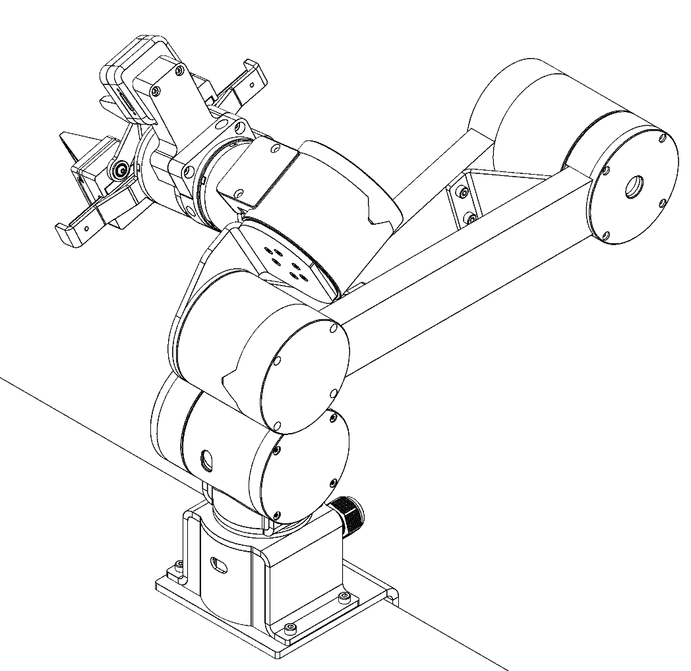
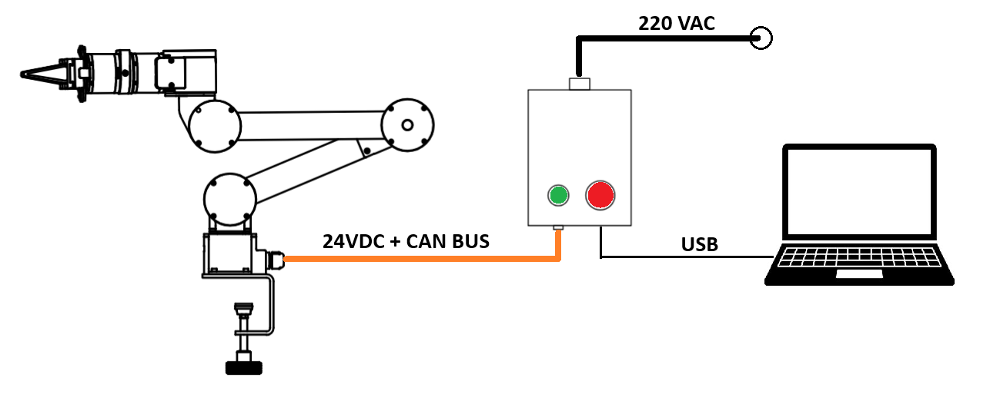

import Tabs from '@theme/Tabs';
import TabItem from '@theme/TabItem';

# Getting Started

From the box to your first movement in five steps. Pick your setup once in the tabs below:
the choice is remembered across the page.

| You need | |
|---|---|
| A PC with **Ubuntu** (24.04 recommended) or **Windows 11** | x86_64 or aarch64 |
| Internet access and admin rights | for the installation |
| A free, stable table, 30–50 mm thick | for the clamp |

:::danger[Three rules before you start]
1. **The arm has no brakes.** When the motors are disabled, the power is cut or the emergency stop is pressed, it **falls**.
2. **Stopping your program does not stop the motors.** They keep executing the last command.
3. **Keep out of reach** of the arm (≈ 0.9 m around the shoulder) while it is powered. The emergency stop is your way to cut power.
:::

## 1. Set up the hardware

**Mount.** Clamp the arm on the table, lifting it only by the base and the links (not by the cables
or the gripper). Tighten the clamp before letting go, then place the arm in its
**resting position**. Every session starts and ends here.



**Wire.** With the **emergency-stop button pressed**, connect in this order:

1. robot → Power Box (orange M12 cable, fits one way, screw it in);
2. Power Box → PC (USB-C);
3. Power Box → mains socket with earth.



**Switch on.** Turn the emergency-stop button clockwise to release it, then press the green start
button. The button lights up and the motor LEDs turn solid red: the motors are powered but disabled,
so the arm does not move yet.

## 2. Prepare your computer

<Tabs groupId="os" queryString>
<TabItem value="ubuntu" label="Ubuntu" default>

Check that the arm's USB port is visible:

```bash
ls /dev/ttyACM0
```

Allow your user to use it (once), then **log out and back in**:

```bash
sudo usermod -aG dialout $USER
```

</TabItem>
<TabItem value="wsl" label="Windows (WSL2)">

On Windows the software runs inside **WSL2**, a Linux system built into Windows.
All `bash` commands on this page go into the **Ubuntu** app, `powershell` ones into
**PowerShell as Administrator**.

**Install WSL2 and Ubuntu**, then open the new Ubuntu app from the Start menu and create a user:

```powershell
wsl --install Ubuntu-24.04
```

**Install usbipd**, which passes the USB port to WSL:

```powershell
winget install --interactive --exact dorssel.usbipd-win
```

and the matching tools inside Ubuntu:

```bash
sudo apt update
sudo apt install -y linux-tools-virtual hwdata
sudo update-alternatives --install /usr/local/bin/usbip usbip /usr/lib/linux-tools/*/usbip 20
```

**Share the port** (once). Reopen PowerShell as Administrator, find the
*USB Serial Device* and note its BUSID:

```powershell
usbipd list
# BUSID  VID:PID    DEVICE                     STATE
# 1-9    2e88:4603  USB Serial Device (COM3)   Not shared   <-- this one
usbipd bind --busid 1-9
```

**Attach it to WSL.** With the Ubuntu app open, run:

```powershell
usbipd attach --wsl --busid 1-9
```

:::note
Repeat `usbipd attach` **every time** you reboot or replug the USB cable.
:::

Finally, inside Ubuntu, check the port and allow your user to use it (once):

```bash
ls /dev/ttyACM0
sudo usermod -aG dialout $USER
```

Then restart WSL so the permission applies: `wsl --shutdown` in PowerShell, and reopen Ubuntu.

</TabItem>
</Tabs>

## 3. Install the API

Not sure which one? Choose **Python**: one command installs everything.

<Tabs groupId="lang" queryString>
<TabItem value="py" label="Python" default>

Run as a normal user (**not** with `sudo`):

```bash
curl -fsSL https://itacarobotics.com/install.sh | bash
```

It asks for your password once, installs the build tools, a conda environment called `ulixenv`
(Python 3.10) and `ulixpy`, then checks that it works. It takes a few minutes; run it again any
time to update.

In **every new terminal**, activate the environment first:

```bash
conda activate ulixenv
```

If `conda` is not found, open a new terminal or run `source ~/.bashrc`.

<details>
<summary>Install into your own Python environment instead (pip)</summary>

Requires Python ≥ 3.10.

```bash
sudo apt install -y build-essential cmake git pkg-config libeigen3-dev libserialport-dev
pip install "git+https://github.com/itacarobotics/ulixpy.git"
python -c "import ulixpy; ulixpy.UlixArm()"   # check
```

</details>

<details>
<summary>Uninstall</summary>

```bash
conda env remove -n ulixenv            # environment and ulixpy
rm -rf /opt/itacarobotics/ulixpy       # source code
rm -rf ~/miniforge3                    # only if the installer installed Miniforge
```

</details>

</TabItem>
<TabItem value="cpp" label="C++">

**Dependencies**: compiler, CMake, Eigen and libserialport:

```bash
sudo apt install -y build-essential cmake git pkg-config libeigen3-dev libserialport-dev
```

**Pinocchio** (used for gravity compensation), from the robotpkg repository (x86_64):

```bash
sudo mkdir -p /etc/apt/keyrings
curl http://robotpkg.openrobots.org/packages/debian/robotpkg.asc | sudo tee /etc/apt/keyrings/robotpkg.asc
echo "deb [arch=amd64 signed-by=/etc/apt/keyrings/robotpkg.asc] http://robotpkg.openrobots.org/packages/debian/pub $(lsb_release -cs) robotpkg" \
  | sudo tee /etc/apt/sources.list.d/robotpkg.list
sudo apt update && sudo apt install -y robotpkg-pinocchio
echo 'export CMAKE_PREFIX_PATH=/opt/openrobots:$CMAKE_PREFIX_PATH' >> ~/.bashrc
echo 'export LD_LIBRARY_PATH=/opt/openrobots/lib:$LD_LIBRARY_PATH' >> ~/.bashrc
source ~/.bashrc
```

Other options are on the [Pinocchio download page](https://stack-of-tasks.github.io/pinocchio/download.html).

**Build** the library and examples:

```bash
git clone --recurse-submodules https://github.com/itacarobotics/ulixarm_cpp.git
cd ulixarm_cpp
cmake -S . -B build -DCMAKE_BUILD_TYPE=Release
cmake --build build -j
sudo cmake --install build   # optional: to use it from your own projects
```

In your own CMake project:

```cmake
find_package(ulixarm_cpp REQUIRED)
target_link_libraries(my_app PRIVATE ulixarm_cpp::ulixarm_core)
```

</TabItem>
</Tabs>

## 4. First program: move the arm by hand

This runs **gravity compensation**: the motors cancel the arm's weight, so it floats and you can
guide it by hand. It is the safest first test, because it applies no stiffness.

Before running: arm in the **resting position**, Power Box switched on, nobody near the arm.

<Tabs groupId="lang" queryString>
<TabItem value="py" label="Python" default>

```python title="gravity.py"
import numpy as np
from ulixpy import UlixArm

robot = UlixArm(gripper=True)
robot.connect("/dev/ttyACM0")
robot.enable()
robot.refresh()

zero = np.zeros(6)
try:
    while True:
        # kp = kd = 0: no stiffness, only gravity compensation
        robot.control(zero, zero, zero, zero, zero, True)
except KeyboardInterrupt:
    pass
finally:
    robot.hold()          # keep the current pose
    robot.disconnect()
```

```bash
conda activate ulixenv
python gravity.py
```

More examples are in `/opt/itacarobotics/ulixpy/examples`.

</TabItem>
<TabItem value="cpp" label="C++">

```bash
./build/examples_gravity /dev/ttyACM0
```

The source is in `examples/gravity.cpp`.

</TabItem>
</Tabs>

Press <kbd>Ctrl</kbd>+<kbd>C</kbd> to stop: the arm **holds** its current pose.

## 5. Operate safely

A typical session, every time:

| | Step | Why |
|---|---|---|
| 1 | Arm in resting position, then switch on | `enable()` gives no holding torque until the first command |
| 2 | `connect()`, `enable()`, then `hold()` or `control()` right away | the arm is only supported once a command is sent |
| 3 | Move in small steps (≤ 0.2 rad per command) | larger jumps are rejected; interpolate motions |
| 4 | Watch the arm, hand near the emergency stop | there is no collision detection |
| 5 | Bring the arm back to the resting position | it falls when disabled |
| 6 | `disable()`, then press the emergency stop | cuts power to the arm |
| 7 | Unplug the mains if unused for a while | |

:::warning[If something goes wrong]
Press the **emergency stop**: power is cut and the arm falls, so keep hands and objects away
from below it. To restart, release the button and press the green start button.
:::

Next: the [Python API](./api/ulixpy.mdx) or [C++ API](./api/ulixarm_cpp.mdx) reference.
