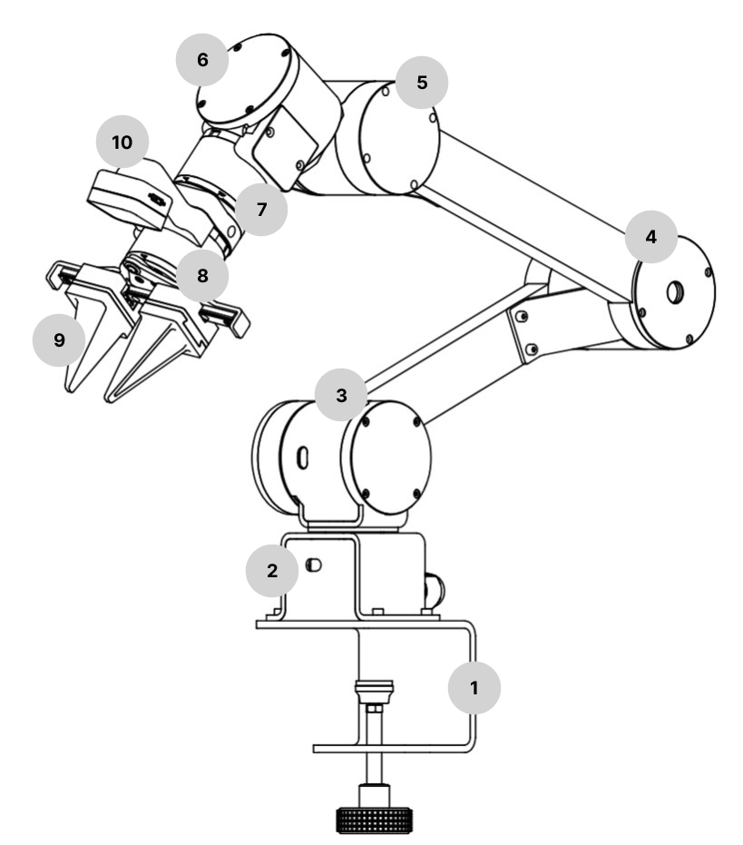
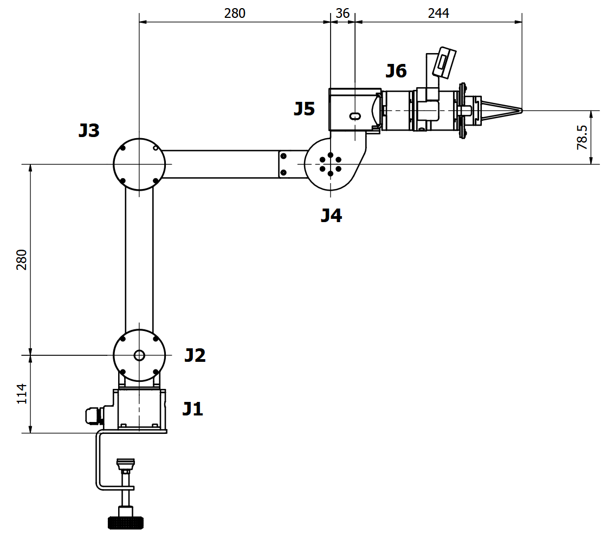

# Ulixarm Research Kit

**Ulixarm** is an open 6-DoF robotic arm with a 1-DoF parallel gripper, built to give students,
researchers and robotics enthusiasts a hands-on entry point into robot control.
It is driven by quasi-direct-drive motors, so it is backdrivable, can be moved by hand, and
lets you experiment with impedance control, gravity compensation and torque-level commands
from day one.

The arm is programmed through the **Ulixarm API**, available in **Python** ([`ulixpy`](./api/ulixpy.mdx))
and **C++** ([`ulixarm_cpp`](./api/ulixarm_cpp.mdx)) with the same function names in both.

| No. | Component | No. | Component |
|---|---|---|---|
| 1 | Table mount (integrated clamp) | 6 | Joint 5 |
| 2 | Joint 1 | 7 | Joint 6 |
| 3 | Joint 2 | 8 | End effector |
| 4 | Joint 3 | 9 | Fingers |
| 5 | Joint 4 | 10 | Camera |

Link *n* connects Joint *n* to Joint *n+1*.

## What's in the kit

- **Arm** with integrated table clamp and end effector (gripper)
- **Power Box** with mains cable, 24 V DC supply, emergency-stop and start buttons
- **Intel RealSense D405** depth camera with a 3 m USB cable
- **USB-C cable (1 m)** to connect the Power Box to your PC
- Cable strips, hex keys, M4×10 and M3×16 bolts
- Euro transport box with custom protective packaging

:::info
A PC or notebook is not included in the kit.
:::

## Software stack

| Package | What it is |
|---|---|
| [`ulixarm_cpp`](./api/ulixarm_cpp.mdx) | C++20 control library: connection, impedance control, gravity compensation, gripper, safety checks |
| [`ulixpy`](./api/ulixpy.mdx) | Python bindings of `ulixarm_cpp`, installable with one command |
| [`ulixarm_description`](./ulixarm_description.mdx) | URDF model with visual/collision meshes and dynamic parameters |

The PC talks to the arm over USB → CAN. Every call to `control()` sends one impedance command
to the six joint motors and reads their feedback.

## Technical specifications

### Arm

| Parameter | Value |
|---|---|
| Degrees of freedom | 6 (+1 gripper) |
| Payload | 1.0 kg at the tool flange incl. tool · 0.3 kg with the supplied gripper |
| Repeatability | 0.1 mm |
| Max reach (J2 axis to fingertips) | 840 mm |
| Max joint speed | J1–J3: 8 rad/s · J4–J6: 30 rad/s |
| Joint torque (rated / peak) | J1–J3: 9 / 28 Nm · J4–J6: 3 / 10 Nm |
| Brakes | None (quasi-direct-drive, backdrivable) |
| Weight | 6 kg |
| Operating conditions | 5–35 °C, 20–80 % RH non-condensing, indoor only |

### Gripper and power

| Parameter | Value |
|---|---|
| Gripper max opening | 90 mm |
| Gripper weight | 0.8 kg |
| Supply | 100–240 V AC, 47–63 Hz → 24 V DC, 240 W |
| Arm cable | M12 (24 V + CAN bus), approx. 2.5 m |
| PC connection | USB-C (USB to CAN transceiver) |

:::danger Read the technical manual
Ulixarm is partly completed machinery. It has **no brakes**: when the motors are disabled or power
is cut (including emergency stop), **the arm falls under gravity**. Operate it only inside a
suitable protective enclosure and follow the safety instructions of the technical manual.
If the online documentation differs from the manual, the limits and safety instructions in the
manual take precedence.
:::

Ready? Head to [Getting Started](./getting-started.mdx).
