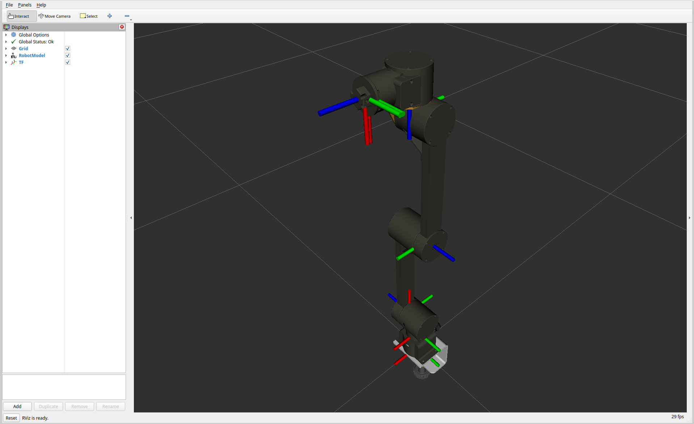
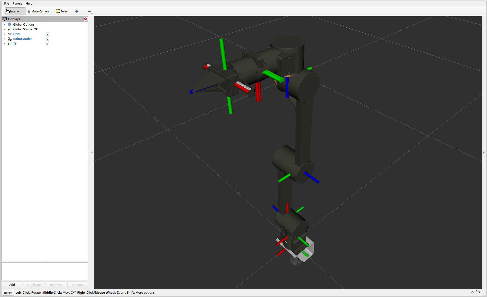
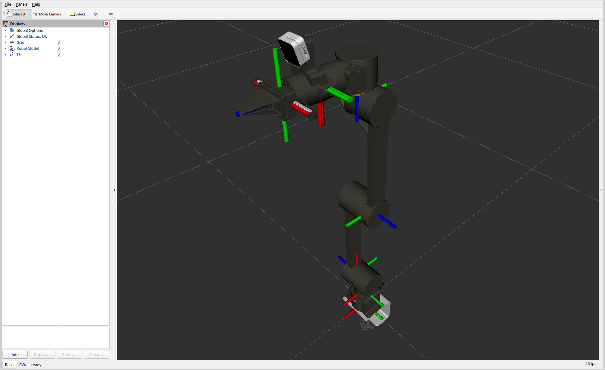
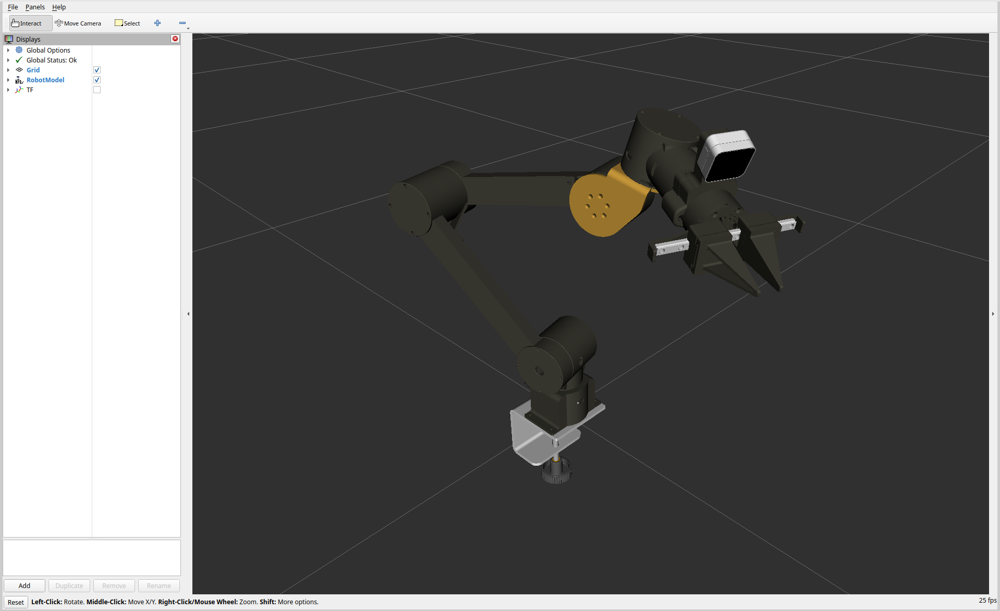
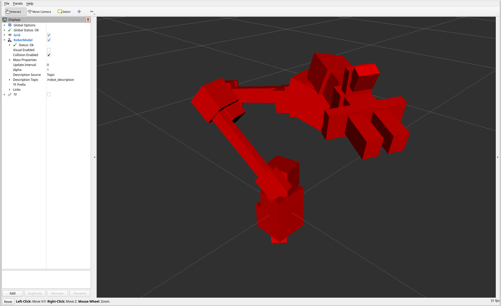

# Robot Description: `ulixarm_description`

The URDF model of the Ulixarm, with visual and collision meshes and **dynamic parameters computed
from the CAD model**. It is used by the API for gravity compensation and can be loaded in any
URDF-compatible tool (Pinocchio, MuJoCo, simulators, visualizers).

Source: [github.com/itacarobotics/ulixarm_description](https://github.com/itacarobotics/ulixarm_description)
(also included as a submodule of `ulixarm_cpp` and `ulixpy`).

## Configurations

Three ready-to-use URDF files are provided:

| File | Configuration |
|---|---|
| `arm.urdf` | Arm only |
| `arm_gripper.urdf` | Arm + gripper |
| `arm_gripper_camera.urdf` | Arm + gripper + camera |

<div className="row margin-vert--md">
  <div className="col col--4 text--center">
    
    <p><strong>Arm</strong></p>
  </div>
  <div className="col col--4 text--center">
    
    <p><strong>Arm + Gripper</strong></p>
  </div>
  <div className="col col--4 text--center">
    
    <p><strong>Arm + Gripper + Camera</strong></p>
  </div>
</div>

The API picks the right file from the `gripper` and `camera` constructor flags
(see [`UlixArm()`](./api/ulixarm_cpp.mdx#ulixarm)). To use your own copy, set
`ULIXARM_DESCRIPTION_PATH` or pass `urdf_path` to the constructor.

## Repository layout

```text
ulixarm_description/
├── assets/
├── src/
│   └── ulixarm_description/
│       ├── meshes/
│       │   ├── collision/
│       │   └── visual/
│       └── urdf/
│           ├── arm.urdf
│           ├── arm_gripper.urdf
│           ├── arm_gripper_camera.urdf
│           ├── robot.urdf.xacro
│           ├── gripper.urdf.xacro
│           └── manipulator.urdf.xacro
├── LICENSE
└── README.md
```

The `.xacro` files keep the description modular: `manipulator.urdf.xacro` (arm),
`gripper.urdf.xacro` (end effector) and `robot.urdf.xacro`, which assembles them.

## Meshes

| Visual | Collision |
|---|---|
|  |  |

## Loading the model

With Pinocchio (installed together with `ulixpy`):

```python
import pinocchio as pin

model = pin.buildModelFromUrdf("arm_gripper.urdf")
data = model.createData()
q = pin.neutral(model)

g = pin.computeGeneralizedGravity(model, data, q)  # gravity torques [Nm]
print(model.nq, g)
```

## Regenerating the URDF files

The three `.urdf` files are generated from `robot.urdf.xacro` with
[xacro](https://github.com/ros/xacro). Regenerate them only if you change the `.xacro` sources.

## License

Apache License 2.0.
