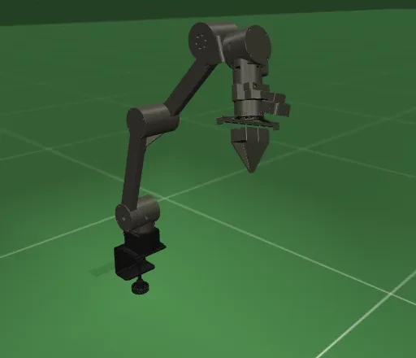

# Gamma Zero (γ₀)

Gamma Zero is a generalist policy for multi-embodiment motion control: one foundation motion policy for robots on the ground or in the air, with wheels, legs or rotors. It is trained across millions of randomized embodiments, generated from an open collection of hundreds of realistic robot models.

## Ulixarm in Gamma Zero

Ulixarm is part of the Gamma Zero robot collection and is one of the project's real-world deployments: the policy runs on the physical arm.

## Team

Gamma Zero is a large research collaboration, co-led by Nico Bohlinger (TU Darmstadt) and Bo Ai (Stanford University).

**Federico Osti** (Technical University of Munich) is a member of the research team.

## Links

- Project website: [gamma-zero.com](https://gamma-zero.com/)
- Interactive playground: [play.gamma-zero.com](https://play.gamma-zero.com/)
- Contribute a robot model: contribute@gamma-zero.com
